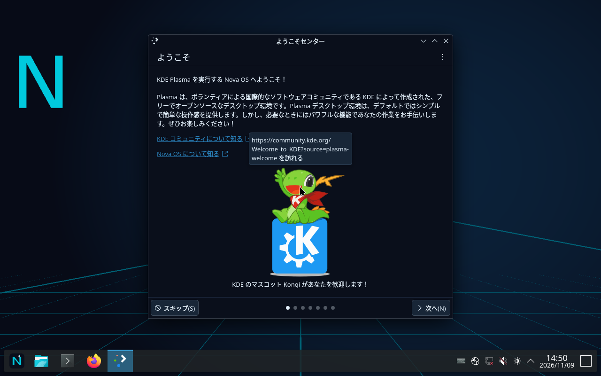

# Nova OS 0.1

Debian 13 (trixie) / x86-64 / KDE Plasma 6 ベースの Live OS 開発リポジトリです。
目標ファイルは **`nova-os-0.1-amd64.iso`**。インストーラーは含めません。

**現在の状態：起動可能なISOを生成済み。QEMU / OVMF / TCG / 標準VGAで、UEFI起動・Liveログイン・Plasmaの応答とパネル・Fcitx5・Nova壁紙の表示を確認しました。**
Codex Cloudではマウント権限がないため、GitHub ActionsのDebian 13コンテナでISOを生成しました。

- **[ISOを取得する（Artifacts）](https://github.com/18s09000-afk/Nova-os/actions/runs/42564094145#artifacts)**：`nova-os-0.1-amd64-2`（約2.3GB）
- **[起動検証の成功結果](https://github.com/18s09000-afk/Nova-os/actions/runs/42569015731)**：同じISOのSHA-256を照合し、現在の検証コードで成功
- [検証記録](docs/VALIDATION.md) / [機械可読の起動結果](docs/validation/boot-result.json)

ISOを生成した実行には、古い日本語ログイン処理のテスト失敗が残っています。
**ISOは再検証に成功した同一ファイルです。** 起動結果は上記の成功した再検証をご覧ください。
日本語の実入力・実機・Secure Boot・専用NVIDIAドライバーは未検証です。



## iPadからビルドしてISOを取得する

1. このリポジトリのファイルをGitHubの `main` に反映します。
2. GitHubの **Actions → Build Nova OS Live ISO → Run workflow** を選びます。
   対象ファイルが更新された `main` へのpushでも自動実行されます。
3. `live-iso` ジョブの設定検査、ISO生成、UEFI QEMUテストを確認します。
4. 実行結果下部の **Artifacts** から `nova-os-0.1-amd64-<実行番号>` をダウンロードし、
   iPadの「ファイル」でZIPを展開します。Artifactsは14日間保持され、GitHubへのログインが必要です。
5. `nova-os-0.1-amd64.iso`、`.iso.sha256`、`boot-result.json`、ログ、
   `qemu-desktop.ppm` が含まれます。PPM画像は対応するビューアで確認できます。

GitHub Actionsが無効ならリポジトリのActionsタブから有効にしてください。
利用可能なActions容量・実行時間・Artifact容量はアカウントの契約に依存します。
失敗時も取得できた診断ファイルをアップロードしますが、ビルド前に失敗した場合はISOはありません。
**Artifactが存在することだけでは起動成功とは判定しません。**

## 内容

- Debian 13 Linux / live-boot / live-config、UEFI用GRUBとBIOS用Syslinux
- Plasma 6 Wayland / SDDM、自動ログインユーザー `nova`
- ダーク／シアン配色、オリジナル壁紙・ロゴ、軽いアニメーション、ぼかし無効
- 下部48pxパネル、NovaアイコンのKickoffランチャー、ピン留めアプリ、時計・トレイ
- Firefox ESR、Konsole、Dolphin、NetworkManager、PipeWire
- 日本語ロケール・Noto CJK・Fcitx5/Mozc（半角/全角などで切り替え）
- 今後のアプリ用ディレクトリ（[apps](apps/README.md)）

Plasma標準のパネルとランチャーを独自設定で構成します。専用の新規ランチャー実装ではありません。
LiveアカウントはDebian live-configの既定パスワード `live`、sudo利用可能です。
永続化は設定しておらず、再起動するとLiveセッションの変更は失われます。
Calamares、専用アプリ、自動更新、バックアップは後続開発です。

## 構成

```text
.github/workflows/build-iso.yml   GitHub Actions → build → QEMU → Artifacts
auto/config                      live-build設定の単一入口
config/package-lists/            Debianパッケージ
config/includes.chroot/          壁紙・ロゴ・Plasma・SDDM・日本語入力設定
config/hooks/live/               ロケール・サービス・Nova識別情報
scripts/build.sh                 独立したbuild/run-*内でISO生成
scripts/smoke-boot.py            ヘッドレスUEFI起動・Liveログイン・GUIプロセス確認
scripts/run-qemu.sh              手動で画面を確認するQEMU起動
scripts/validate.sh              設定・シェル・公式パッケージ依存関係検査
artwork/                         オリジナルSVGソース
apps/                            将来の専用アプリ予約領域
docs/                            検証記録と障害対処
build/                           生成物・失敗時の作業ツリー（Git対象外）
dist/                            ISO・チェックサム・ログ（Git対象外）
```

## Linuxクラウドでの手動ビルド

推奨はGitHub提供のUbuntu 24.04ランナーと、その上のDebian 13コンテナです。
別のLinuxクラウドを使う場合も、rootful Dockerの `--privileged` または完全なDebian 13 VMが必要です。
rootless Dockerやマウントを禁止するコンテナでは生成できません。
推奨リソースはamd64、2 CPU以上、RAM 8GB以上、空きディスク30GB以上です。
CIは空き20GiB未満なら早期停止します。

Debian 13 amd64 VMにチェックアウト済みの場合：

```sh
sudo ./scripts/install-build-deps.sh
sudo ./scripts/validate.sh
sudo env NOVA_JOBS=2 ./scripts/build.sh
python3 ./scripts/smoke-boot.py --timeout 1000
(cd dist && sha256sum -c nova-os-0.1-amd64.iso.sha256)
```

rootful Dockerが使えるLinuxクラウドで、リポジトリのルートから実行する場合：

```sh
docker run -d --name nova-build --privileged \
  --mount type=bind,src="$PWD",dst=/src -w /src debian:trixie-slim sleep infinity
docker exec nova-build ./scripts/install-build-deps.sh
docker exec nova-build ./scripts/validate.sh
docker exec -e NOVA_JOBS=2 nova-build ./scripts/build.sh
docker exec nova-build python3 scripts/smoke-boot.py --timeout 1000
docker rm -f nova-build
```

`--privileged` はビルドに必要なマウント・chroot等のためです。使い捨てクラウドランナーで実行し、
ホストの `/dev`、実機ブロックデバイス、Dockerソケットは渡しません。
既存の作業ツリーを使用し、追加のGit worktreeは不要です。
HTTP(S)プロキシを使う環境では既存の設定とCA信頼を使用し、署名・TLS検証を無効にしないでください。
必要な接続先は `github.com`、Docker Hub関連ホスト、`deb.debian.org`、`security.debian.org`、
およびActions標準のArtifactサービスです。

各ビルドは新しい `build/run-*` で実行し、失敗内容を残します。成功したISOを `dist/` にコピーします。
古い作業ツリーはマウントが残っていないことを確認してから管理してください。
Debianミラーとコンテナタグは更新されるため、同一手順で再生成可能ですが**バイト単位の再現性は保証しません**。
ISO内 `/usr/share/nova/packages.tsv` と `dist/*.packages` に解決されたパッケージ版を記録します。

## QEMU検証

自動テストはKVMに依存せずTCGとOVMFを使用し、ホストSSD・仮想ハードディスク・ネットワークを接続しません。
Liveユーザーとしてシリアルコンソールにログイン後、SDDM、`plasmashell`、`fcitx5`、壁紙の存在を確認します。
PlasmaのD-Bus応答とパネル数も確認します。成功マーカーを実際のゲスト出力から受信した場合のみ成功し、タイムアウトは失敗です。
最初のソフトウェア描画を待って画面を保存します。日本語の変換操作や各アプリの操作は手動確認が必要です。

GUIを使えるLinux環境では次で手動確認できます：

```sh
./scripts/run-qemu.sh
# GUIがないクラウドでの自動検証
python3 scripts/smoke-boot.py
```

目視確認：Nova壁紙とシアン配色、下部パネル、Firefox起動、Konsole・Dolphin、
Mozcで「日本語」の入力、再起動後のLiveデスクトップ。
Secure Bootは未対応・未検証です。UEFIテストはSecure Boot無効で行います。
RTX 3060用の専用NVIDIAドライバーや実機固有のWi-Fi・サスペンド・ゲーム性能は未検証です。
USB書き込み・SSD変更・実機インストールの処理は、このリポジトリにはありません。

## ISOを再ビルドせず起動テストを再実行する

Actionsの **Retest existing Nova ISO → Run workflow** に、元のビルドURLの実行IDを入力します。
例：`.../actions/runs/42564094145` の場合は `42564094145`。
保存済みISOのSHA-256を検証してから、現在のテストコードでQEMUを起動します。
小さな検証用Artifactsには結果・ログ・PNG画面が入り、ISOは元のビルドのArtifactsから取得します。
元のArtifactsが有効であることが必要です。

診断結果は `ci-diagnostics/` で始まる専用ブランチにも自動保存します。
通常のOSソースは `main` にあります。診断ブランチは生成物の確認用です。
Codexからは `ci-retest/<元のビルド実行ID>` ブランチへのpushでも再検証できます。
